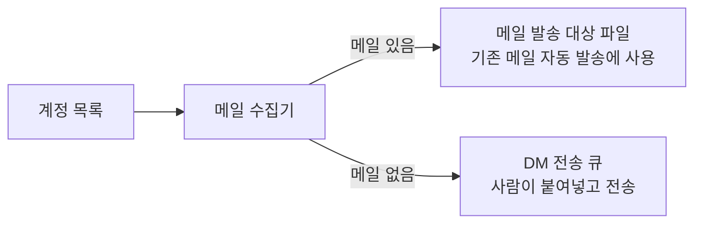

# 인스타그램 시딩 자동화 — 메일 수집기와 DM 전송 큐

**문제** · 이미 찾은 인스타그램 계정에서 메일 주소를 모으고 첫 DM을 일괄 발송하는 일이 막혀 있습니다.  
**해결** · 소개글의 메일은 자동으로 CSV에 모읍니다. 메일이 없는 계정은 DM 문안과 링크를 준비하고 담당자가 확인해 전송합니다.  
**실행 비용 0원** · 샘플은 계정·토큰 없이 실행할 수 있습니다. [과제 배경](MASTER.md) · [AI 사용 내역](AI_USAGE.md)  
**바로 해 보기** · Python이 있는 PC에서 **Code → Download ZIP → 압축 풀기** 후 `collect_emails.py`가 보이는 폴더에서 터미널을 열고 두 줄을 실행하세요.

```sh
python collect_emails.py --sample
python make_dm_queue.py --sample
```

Windows에서 `python` 명령을 찾지 못하고 `py`가 설치되어 있다면 두 줄의 `python`을 `py`로 바꾸세요.

**결과 확인** · `output/sample_emails_mail.csv`를 열면 메일 대상 6명, `output/sample_dm_queue.html`을 더블클릭하면 DM 대상 4명의 문안이 보입니다. 나머지 1명은 수동 확인입니다. 샘플은 아무 메시지도 보내지 않습니다.

인스타그램 시딩에서 손으로 하던 두 가지, **이미 찾은 계정의 메일 주소 수집**과 **DM 발송 준비**를 자동화하는 파이썬 도구입니다. 파이썬만 있으면 돌아가고, 따로 설치할 것이 없습니다.

[실무 안내서 PDF](docs/복순도가%20인스타그램%20시딩%20실무%20안내서.pdf) · [Meta 초기 설정 안내서 PDF](docs/Meta%20초기%20설정%20안내서.pdf)

과제 배경과 문제 정의는 [MASTER.md](MASTER.md)에 있습니다.

## 무엇을 해 주는가

| | 막혀 있던 일 | 이 도구가 하는 일 | 사람이 하는 일 |
|---|---|---|---|
| **A** | 찾은 계정의 메일 주소 수집 | 계정 목록을 넣으면 계정마다 소개글에서 메일을 찾아 표로 만듦 | 없음 |
| **B** | DM 일괄 발송 | 메일이 없는 계정만 골라 문안을 만들고, 이미 연락한 계정을 빼고, 버튼 하나로 문안 복사와 DM 창 열기까지 함 | 붙여넣기와 전송 |

메일이 있는 계정은 기존 메일 자동 발송으로 넘기고, 없는 계정만 DM으로 보내는 구조입니다. 메일이 잡히는 만큼 손으로 보내는 DM이 줄어듭니다.



## ① 샘플로 동작 확인하기

입력만 가상입니다. 실제 Instagram에 접속하는 대신 저장소의 샘플 소개글 11개를 읽고, 실사용과 같은 코드로 메일 추출·대상 분류·DM 문안 생성을 실행합니다. 샘플을 실행해도 인스타그램 로그인이나 실제 발송은 일어나지 않습니다. ZIP으로 내려받았다면 맨 위의 두 줄만 실행하세요. Git을 사용한다면 아래처럼 시작할 수 있습니다.

```
git clone https://github.com/wonyoungjacob/seeding-automation.git
cd seeding-automation
python collect_emails.py --sample
python make_dm_queue.py --sample
```

메일 수집 명령의 결과는 이렇게 나옵니다.

```
결과
  전체: 11
  조회됨: 10
  메일 확보: 6
  DM 대상: 4
  수동 확인: 1
  메일 확보율(조회된 계정 중): 60%
```

`output` 폴더에 결과가 생깁니다. `sample_emails.csv`는 엑셀로, `sample_dm_queue.html`은 브라우저로 여세요. 샘플의 60%는 가상 데이터의 수치이고 실제 확보율이 아닙니다.

## 실제 계정으로 쓰기

**② 실제 조회를 재현하려면** 조회를 실행할 담당자 본인의 Meta 연결이 필요합니다. 아래에서 토큰과 숫자 ID는 **담당자 계정**의 것이고, CSV에는 **조회할 상대 계정**을 적습니다. 상대방의 비밀번호나 토큰은 필요 없습니다.

### 준비물 (한 번만)

1. **인스타그램 프로페셔널 계정**(비즈니스 또는 크리에이터)과 **연결된 페이스북 페이지**
2. **Meta 개발자 앱의 액세스 토큰**. 비용은 없습니다.
   1. [developers.facebook.com](https://developers.facebook.com)에 로그인해 앱을 하나 만듭니다.
   2. [Graph API 탐색기](https://developers.facebook.com/tools/explorer/) 오른쪽 **Meta 앱**에서 방금 만든 앱을 고릅니다. **사용자 또는 페이지 → 사용자 액세스 토큰 받기**를 선택합니다. 권한을 고르는 곳은 그 아래 **Permissions(권한) → 권한 추가**입니다.
   3. `pages_show_list`, `pages_read_engagement`, `instagram_basic`, `instagram_manage_insights`를 하나씩 검색해 선택합니다. **Generate Access Token**을 누르고 로그인 창에서 연결한 페이지와 인스타그램 계정을 승인합니다.
   4. 단기 사용자 토큰은 수 시간, 장기 사용자 토큰은 통상 약 60일간 유효합니다. [토큰 디버거](https://developers.facebook.com/tools/debug/accesstoken/)에서 실제 만료일을 확인하고, 갱신한 값은 담당자 PC의 .env에 저장합니다.

**처음 열었는데 권한 4개가 다 보이지 않나요?**

1. **목록에 필요한 이름이 없을 때** — 새 탭에서 **내 앱 → 내 앱 이름 → 이용 사례 → Instagram에서 메시지 및 콘텐츠 관리 → 맞춤 설정**으로 들어갑니다. **Facebook 로그인이 포함된 API 설정 → 필수 권한 추가**에서 콘텐츠 권한을 추가합니다. 버튼이 이미 **Go to permissions and features**로 바뀌었다면 그 버튼을 누릅니다.
2. **메시지 권한만 보일 때** — **권한 및 기능**에서 `instagram_manage_insights`(인사이트 조회)를 검색해 추가합니다. `instagram_manage_messages`는 DM용이라 이 자리에 쓸 수 없습니다. 탐색기 탭을 새로 고치고 같은 앱을 선택한 뒤 **권한 추가**에서 네 이름을 다시 확인합니다.
3. **사용자 토큰을 눌러도 승인 창이 열리지 않을 때** — 앱 대시보드의 **비즈니스용 Facebook 로그인 → 구성 → 구성 만들기**에서 **사용자 액세스 토큰**을 고르고 네 권한을 선택해 저장합니다. 탐색기의 **Configurations(구성)** 탭에서 저장한 구성을 선택한 뒤 **Generate Access Token**을 누릅니다.

발급 후에는 [토큰 디버거](https://developers.facebook.com/tools/debug/accesstoken/)의 권한 목록에서 네 이름이 모두 있는지 확인합니다. 빠진 권한을 추가했다면 토큰을 다시 발급해 사용하세요. 같은 절차는 [Meta 초기 설정 안내서 PDF](docs/Meta%20초기%20설정%20안내서.pdf) 3~4쪽에도 있습니다.

### 실행

```
cp .env.example .env
```

위 복사 명령은 Windows PowerShell과 macOS 터미널에서 사용할 수 있습니다. 처음 설정할 때 한 번만 실행하세요. 새로 생긴 `.env` 파일에서 `IG_ACCESS_TOKEN=` 뒤에 토큰을 붙여넣고 본인 PC에만 저장하세요. 같은 폴더에 `계정목록.csv`를 만들고 첫 줄에 `계정`, 다음 줄부터 실제 대상의 인스타 아이디를 하나씩 넣으세요. 운영 확보율을 측정하려면 메일 유무로 선별하지 않고 실제 시딩 후보 목록을 그대로 넣으세요.

```
python check_setup.py
python collect_emails.py 계정목록.csv
python make_dm_queue.py
```

첫 명령은 연결을 확인하고 본인 인스타그램의 숫자 ID를 저장합니다. 계정이 여러 개면 원하는 ID를 선택하라는 안내를 따르세요. 페이지 목록이 비어 있다면 Meta 비즈니스 설정 → 계정 → Instagram 계정에서 **본인 프로페셔널 계정의 숫자 ID**를 확인해 `.env`의 `IG_USER_ID=` 뒤에 넣고 두 번째 명령부터 실행하세요. 이번 실계정 검증도 이 방법으로 성공했습니다.

**성공 여부 확인:** `output/emails.csv`의 ‘메일’과 실제 공개 소개글을 비교하세요. 메일이 잡힌 대상은 `output/emails_mail.csv`에, 메일 없이 조회된 미연락 대상은 `output/dm_queue.html`에 나타납니다. 조회 불가 계정은 전체 표에서 ‘수동 확인’으로 표시됩니다. 파일을 여는 것만으로 검증할 수 있으며 메일이나 DM을 보낼 필요는 없습니다.

**계정 목록 파일**은 한 줄에 계정 하나씩 적으면 됩니다. `abc`, `@abc`, `https://www.instagram.com/abc/` 모두 됩니다. 엑셀에서 CSV로 저장한 파일도 그대로 읽습니다. 열이 여러 개면 `계정` 또는 `username` 열을 쓰고, 그런 열이 없으면 첫 번째 열을 씁니다.

## 결과 파일

| 파일 | 내용 |
|---|---|
| `output/emails.csv` | 전체 결과. 계정마다 메일, 메일 출처, 다음 행동(메일 발송, DM, 수동 확인), 팔로워, 소개글 |
| `output/emails_mail.csv` | 메일이 잡힌 계정만. 기존 메일 자동 발송에 넣는 파일 |
| `output/dm_queue.html` | 오늘 보낼 DM 큐. 브라우저로 엽니다 |
| `output/dm_queue.csv` | 큐와 같은 내용의 표 |
| `output/contact_log.csv` | 연락 기록. 여기 있는 계정은 큐에 다시 나오지 않습니다 |

- **확인 필요** 열이 "예"인 메일은 `abc 골뱅이 naver 닷컴`처럼 변형해 적은 것을 풀어낸 주소입니다. 소개글과 한 번 비교해 주세요.
- 중간에 멈춰도 그때까지의 결과는 저장됩니다. 같은 명령을 다시 실행하면 조회가 끝난 계정은 건너뛰고 이어서 합니다.

## DM 전송 큐 쓰는 법

1. `output/dm_queue.html`을 브라우저로 엽니다. 팔로워가 많은 순으로 하루치(기본 20명)가 나옵니다.
2. **복사하고 프로필 열기**를 누르면 문안이 복사되고 그 계정의 프로필이 새 탭에 열립니다. 휴대폰에서는 **복사하고 DM 열기**를 누르면 DM 창이 바로 열립니다.
3. 붙여넣고 전송합니다. 문안은 페이지에서 미리 고칠 수 있습니다.
4. 링크를 열면 ‘보냄’이 체크됩니다. 실제로 보내지 않은 계정은 체크를 해제하세요. 다 보냈으면 **보낸 목록 내려받기**를 누르고, 내려받은 파일을 연락 기록에 합칩니다.

```
python make_dm_queue.py --import-sent sent_2026-11-18.csv
```

다음에 큐를 만들면 이미 보낸 계정은 빠지고 다음 순번이 나옵니다. 문안은 `templates/dm_template.txt`를 고치면 되고, `{계정}` 자리에 계정명이 들어갑니다. 하루 발송 수는 `--limit 30`처럼 바꿉니다.

## 자동화되는 것과 안 되는 것

| | 항목 | 자동화 | 설명 |
|---|---|---|---|
| A | 소개글에 적힌 메일 | ✅ | 표준 표기와 변형 표기(골뱅이, (at), 띄어쓰기) 모두 찾음 |
| A | 프로필 "이메일" 버튼에만 있는 메일 | ❌ | 공식 API에 이 값을 주는 항목이 없음. DM 대상으로 넘어감 |
| A | 링크 모음 페이지(링크트리 등) 안의 메일 | ❌ | 인스타그램이 아닌 다른 사이트라 자동으로 긁지 않음. 결과에 "링크 모음 페이지 있음"으로 표시해 사람이 눌러 볼 수 있게 함 |
| A | 개인 계정 | ❌ | 공식 API는 프로페셔널 계정만 조회됨. "수동 확인"으로 표시 |
| B | 대상 선정, 문안 작성, 중복 제외, 하루 발송량, DM 창 열기, 기록 | ✅ | |
| B | DM 전송 | ❌ | 공식 API는 상대가 먼저 메시지를 보내야만 대화를 열 수 있음 |

공식 API가 첫 DM 자동 발송을 막고 있어, 담당자가 마지막에 직접 전송합니다.

## 비용

0원입니다. 인스타그램 공식 API는 무료이고, 이 도구는 AI를 호출하지 않아 토큰 비용이 없습니다.

## 검증 상태

| 항목 | 상태 |
|---|---|
| 자동 테스트 42개 (`python -m unittest`) | 통과 |
| 샘플 데이터로 전체 흐름 실행 | 확인 |
| DM 큐 페이지가 브라우저에서 열리고 동작 | 확인 |
| 실제 인스타그램 API 호출 | 별도 앱 검수 신청 없이 본인 앱의 토큰과 숫자 계정 ID로 대상 3개 조회 성공 |
| 실제 계정에서의 메일 확보율 | 실계정 3곳의 소개글로 추출 기능 확인. 실제 업무 목록의 확보율은 미측정. 프로필 이메일 버튼에만 있는 주소는 수집 불가 |

찾아 두신 실제 후보 목록을 주시면 전체 고유 후보 중 메일을 확보한 계정의 비율과 조회 불가 건수를 함께 산출해 드리겠습니다. 첫 설정과 토큰 갱신 방법도 함께 안내하겠습니다. 샘플 화면의 확보율은 조회 성공 계정만을 기준으로 합니다.

실계정 테스트에서 이메일과 DM 발송은 각각 0건입니다. DM 대상 선정·문안 생성은 가상 계정으로 확인했습니다.

## 문제가 생겼을 때

| 메시지 | 조치 |
|---|---|
| 액세스 토큰이 만료됐거나 잘못됐습니다 | 토큰을 새로 발급해 `.env`에 넣기 |
| 토큰에 필요한 권한이 없습니다 | 위 권한 네 개가 선택됐는지 확인 |
| API 호출 한도에 걸렸습니다 | 한 시간쯤 뒤 같은 명령을 다시 실행. 이어서 합니다 |
| 파일이 엑셀에 열려 있어 저장할 수 없습니다 | 엑셀을 닫고 다시 실행 |
| 인스타그램 계정을 찾지 못했습니다 | 프로페셔널 계정인지, 페이스북 페이지와 연결됐는지 확인 |

## 폴더 구성

```
collect_emails.py      A. 메일 수집기 실행
make_dm_queue.py       B. DM 전송 큐 실행
check_setup.py         실제 계정 연결 확인
seeding/               동작 코드 (API 연결, 메일 찾기 규칙, 큐 페이지)
templates/             DM 문안
sample/                토큰 없이 돌려 보는 가상 데이터
tests/                 자동 테스트
docs/instagram-api.md  인스타그램 API로 되는 것과 안 되는 것 조사
MASTER.md              과제 배경과 문제 정의
AI_USAGE.md            AI 사용 내역
```
