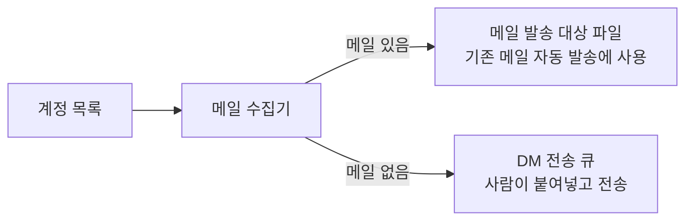

# 인스타그램 시딩 자동화 — 메일 수집기와 DM 전송 큐

인스타그램 시딩에서 손으로 하던 두 가지, **이미 찾은 계정의 메일 주소 수집**과 **DM 발송 준비**를 자동화하는 파이썬 도구입니다. 파이썬만 있으면 돌아가고, 따로 설치할 것이 없습니다.

과제 배경과 문제 정의는 [MASTER.md](MASTER.md)에 있습니다.

## 무엇을 해 주는가

| | 막혀 있던 일 | 이 도구가 하는 일 | 사람이 하는 일 |
|---|---|---|---|
| **A** | 찾은 계정의 메일 주소 수집 | 계정 목록을 넣으면 계정마다 소개글에서 메일을 찾아 표로 만듦 | 없음 |
| **B** | DM 일괄 발송 | 메일이 없는 계정만 골라 문안을 만들고, 이미 연락한 계정을 빼고, 버튼 하나로 문안 복사와 DM 창 열기까지 함 | 붙여넣기와 전송 |

메일이 있는 계정은 기존 메일 자동 발송으로 넘기고, 없는 계정만 DM으로 보내는 구조입니다. 메일이 잡히는 만큼 손으로 보내는 DM이 줄어듭니다.



## 1분 만에 돌려 보기

토큰도 설치도 필요 없습니다. 가상의 샘플 계정 11개로 전체 흐름이 돌아갑니다.

```
git clone https://github.com/wonyoungjacob/seeding-automation.git
cd seeding-automation
python collect_emails.py --sample
python make_dm_queue.py --sample
```

첫 명령의 결과는 이렇게 나옵니다.

```
결과
  전체: 11
  조회됨: 10
  메일 확보: 6
  DM 대상: 4
  수동 확인: 1
  메일 확보율(조회된 계정 중): 60%
```

`output` 폴더에 결과가 생깁니다. `sample_emails.csv`는 엑셀로, `sample_dm_queue.html`은 브라우저로 여세요. 샘플의 60%는 가상 데이터의 수치이고 실제 확보율이 아닙니다.

## 실제 계정으로 쓰기

### 준비물 (한 번만)

1. **인스타그램 프로페셔널 계정**(비즈니스 또는 크리에이터)과 **연결된 페이스북 페이지**
2. **Meta 개발자 앱의 액세스 토큰**. 비용은 없습니다.
   1. [developers.facebook.com](https://developers.facebook.com)에 로그인해 앱을 하나 만듭니다.
   2. [Graph API 탐색기](https://developers.facebook.com/tools/explorer/)에서 그 앱을 고르고, 권한 네 개를 추가합니다: `pages_show_list`, `pages_read_engagement`, `instagram_basic`, `instagram_manage_insights`
   3. 토큰을 생성하고, 로그인 창에서 인스타그램 계정과 페이지를 선택합니다.
   4. 이 토큰은 한두 시간 뒤 만료됩니다. 오래 쓰려면 [액세스 토큰 디버거](https://developers.facebook.com/tools/debug/accesstoken/)에서 토큰을 연장합니다(약 60일).

Meta가 화면 구성을 자주 바꾸므로 메뉴 이름은 다를 수 있습니다.

### 실행

```
copy .env.example .env          (맥은 cp .env.example .env)
```

`.env` 파일을 열어 `IG_ACCESS_TOKEN=` 뒤에 토큰을 붙여넣고 저장합니다. 그다음 순서대로 실행합니다.

```
python check_setup.py                 연결 확인. 계정 ID를 찾아 .env에 저장합니다
python collect_emails.py 계정목록.csv  메일 수집
python make_dm_queue.py               DM 전송 큐 만들기
```

**계정 목록 파일**은 한 줄에 계정 하나씩 적으면 됩니다. `abc`, `@abc`, `https://www.instagram.com/abc/` 모두 됩니다. 엑셀에서 CSV로 저장한 파일도 그대로 읽습니다. 열이 여러 개면 `계정` 또는 `username` 열을 쓰고, 그런 열이 없으면 첫 번째 열을 씁니다.

## 결과 파일

| 파일 | 내용 |
|---|---|
| `output/emails.csv` | 전체 결과. 계정마다 메일, 메일 출처, 다음 행동(메일 발송, DM, 수동 확인), 팔로워, 소개글 |
| `output/emails_mail.csv` | 메일이 잡힌 계정만. 기존 메일 자동 발송에 넣는 파일 |
| `output/dm_queue.html` | 오늘 보낼 DM 큐. 브라우저로 엽니다 |
| `output/dm_queue.csv` | 큐와 같은 내용의 표 |
| `output/contact_log.csv` | 연락 기록. 여기 있는 계정은 큐에 다시 나오지 않습니다 |

- **확인 필요** 열이 "예"인 메일은 `abc 골뱅이 naver 닷컴`처럼 변형해 적은 것을 풀어낸 주소입니다. 소개글과 한 번 비교해 주세요.
- 중간에 멈춰도 그때까지의 결과는 저장됩니다. 같은 명령을 다시 실행하면 조회가 끝난 계정은 건너뛰고 이어서 합니다.

## DM 전송 큐 쓰는 법

1. `output/dm_queue.html`을 브라우저로 엽니다. 팔로워가 많은 순으로 하루치(기본 20명)가 나옵니다.
2. **복사하고 프로필 열기**를 누르면 문안이 복사되고 그 계정의 프로필이 새 탭에 열립니다. 휴대폰에서는 **복사하고 DM 열기**를 누르면 DM 창이 바로 열립니다.
3. 붙여넣고 전송합니다. 문안은 페이지에서 미리 고칠 수 있습니다.
4. 다 보냈으면 **보낸 목록 내려받기**를 누르고, 내려받은 파일을 연락 기록에 합칩니다.

```
python make_dm_queue.py --import-sent sent_2026-11-18.csv
```

다음에 큐를 만들면 이미 보낸 계정은 빠지고 다음 순번이 나옵니다. 문안은 `templates/dm_template.txt`를 고치면 되고, `{계정}` 자리에 계정명이 들어갑니다. 하루 발송 수는 `--limit 30`처럼 바꿉니다.

## 자동화되는 것과 안 되는 것

| | 항목 | 자동화 | 설명 |
|---|---|---|---|
| A | 소개글에 적힌 메일 | ✅ | 표준 표기와 변형 표기(골뱅이, (at), 띄어쓰기) 모두 찾음 |
| A | 프로필 "이메일" 버튼에만 있는 메일 | ❌ | 공식 API에 이 값을 주는 항목이 없음. DM 대상으로 넘어감 |
| A | 링크 모음 페이지(링크트리 등) 안의 메일 | ❌ | 인스타그램이 아닌 다른 사이트라 자동으로 긁지 않음. 결과에 "링크 모음 페이지 있음"으로 표시해 사람이 눌러 볼 수 있게 함 |
| A | 개인 계정 | ❌ | 공식 API는 프로페셔널 계정만 조회됨. "수동 확인"으로 표시 |
| B | 대상 선정, 문안 작성, 중복 제외, 하루 발송량, DM 창 열기, 기록 | ✅ | |
| B | DM 전송 | ❌ | 공식 API는 상대가 먼저 메시지를 보내야만 대화를 열 수 있음 |

**DM 전송까지 자동화하지 않은 이유.** 프로그램이나 AI가 브라우저 화면을 대신 조작해 보내는 방법은 기술적으로는 되지만 인스타그램 약관이 금지하는 비공식 자동화이고, 걸리면 브랜드 계정이 제한됩니다. AI가 화면을 보며 조작하는 방식은 비용도 큽니다. DM 100건에 약 1.3만~7만 원으로 추정되고, 건당 40~60초가 걸려 사람이 붙여넣는 것(15~20초)보다 느립니다. 그래서 전송 한 번만 사람에게 남기고 그 앞을 전부 자동화했습니다.

## 비용

0원입니다. 인스타그램 공식 API는 무료이고, 이 도구는 AI를 호출하지 않아 토큰 비용이 없습니다.

## 검증 상태

| 항목 | 상태 |
|---|---|
| 자동 테스트 42개 (`python -m unittest`) | 통과 |
| 샘플 데이터로 전체 흐름 실행 | 확인 |
| DM 큐 페이지가 브라우저에서 열리고 동작 | 확인 |
| 실제 인스타그램 API 호출 | **아직 안 함.** 토큰이 필요함 |
| 실제 계정에서의 메일 확보율 | **아직 모름.** 실제 계정 목록으로 측정 예정 |

실제 API 호출 부분은 Meta 공식 문서의 요청·응답 형식에 맞춰 작성했고, 샘플 모드도 같은 형식을 씁니다.

## 문제가 생겼을 때

| 메시지 | 조치 |
|---|---|
| 액세스 토큰이 만료됐거나 잘못됐습니다 | 토큰을 새로 발급해 `.env`에 넣기 |
| 토큰에 필요한 권한이 없습니다 | 위 권한 네 개가 선택됐는지 확인 |
| API 호출 한도에 걸렸습니다 | 한 시간쯤 뒤 같은 명령을 다시 실행. 이어서 합니다 |
| 파일이 엑셀에 열려 있어 저장할 수 없습니다 | 엑셀을 닫고 다시 실행 |
| 인스타그램 계정을 찾지 못했습니다 | 프로페셔널 계정인지, 페이스북 페이지와 연결됐는지 확인 |

## 폴더 구성

```
collect_emails.py      A. 메일 수집기 실행
make_dm_queue.py       B. DM 전송 큐 실행
check_setup.py         실제 계정 연결 확인
seeding/               동작 코드 (API 연결, 메일 찾기 규칙, 큐 페이지)
templates/             DM 문안
sample/                토큰 없이 돌려 보는 가상 데이터
tests/                 자동 테스트
docs/instagram-api.md  인스타그램 API로 되는 것과 안 되는 것 조사
MASTER.md              과제 배경과 문제 정의
AI_USAGE.md            AI 사용 내역
```
