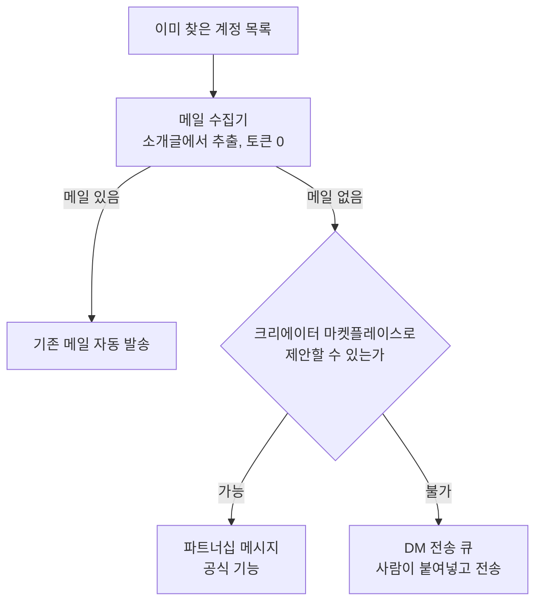

# 인스타그램 시딩 — 메일 수집과 DM 발송 자동화 검토

> **상태: 초안, 검토 중** (제출 기한 2026-11-20 11:30)
> 이 파일이 메인 문서입니다. 여기에 계속 고쳐 나갑니다. 샤오홍슈는 인스타그램 다음에 다룹니다.

## 1. 문제 정의

복순도가의 인스타그램 시딩은 계정 발굴까지는 됩니다. 막힌 곳은 두 군데입니다.

| | 막힌 일 | 막힌 이유 |
|---|---|---|
| **A** | 이미 찾은 계정의 메일 주소 자동 수집 | 공식 API에 메일 주소 항목이 없음 |
| **B** | DM 일괄 발송 | 공식 API가 첫 DM 발송을 허용하지 않음 |

둘 중 하나만 풀려도 됩니다. 메일을 얻으면 이미 있는 메일 자동 발송 흐름에 태울 수 있고, DM을 보낼 수 있으면 메일이 필요 없기 때문입니다.

방법을 고르는 기준은 세 가지입니다.

1. **약관**: 플랫폼 이용약관과 국내법을 지키는가
2. **토큰 비용**: AI를 쓸 때 돈이 얼마나 드는가
3. **사람 시간**: 담당자의 손이 얼마나 가는가

## 2. 결론 먼저

1. **A는 상당 부분 풀립니다.** 공식 API가 주는 소개글에서 메일 주소를 뽑으면 됩니다. 토큰이 들지 않습니다. 다만 소개글에 메일을 적지 않고 프로필의 "이메일" 버튼에만 넣어 둔 계정은 잡히지 않습니다. 몇 퍼센트가 잡히는지는 실제 계정 목록으로 재 봐야 압니다.
2. **B는 "직접 만든 프로그램으로 일괄 발송"하는 방식으로는 약관 안에서 풀리지 않습니다.** 대신 Meta가 만든 공식 경로가 있습니다. **크리에이터 마켓플레이스의 파트너십 메시지**입니다. 한국은 2024년 5월부터 지원하고, 카페24가 2026년 10월 29일에 이 기능을 연동했습니다. 복순도가 공식몰은 카페24 기반으로 보이므로, 개발 없이 쓸 수 있는지부터 확인할 가치가 있습니다.
3. **Claude가 브라우저 화면을 직접 조작하는 방식은 권하지 않습니다.** 약관 위반이고, DM 100건에 약 1.3만~7만 원이 들며, 사람이 붙여넣는 것보다 빠르지도 않습니다. 메일 수집에서는 무료인 API 방식보다 더 얻는 것이 거의 없습니다.
4. **제안하는 조합**: 메일 수집기로 메일이 있는 계정을 먼저 걸러 기존 메일 발송에 넘기고, 남은 계정은 파트너십 메시지 또는 사람이 전송만 누르는 DM 큐로 처리합니다.

## 3. 수집한 사실

2026-11-17에 공식 문서와 기사로 확인했습니다. 전체 목록은 [부록: 인스타그램 API 조사](docs/instagram-api.md)에 있습니다.

| 사실 | 의미 |
|---|---|
| Business Discovery API는 다른 프로페셔널 계정의 소개글과 웹사이트 링크를 준다 | 소개글에 적힌 메일은 공식 경로로 읽을 수 있음 |
| API에 "이메일 버튼"의 주소를 주는 항목은 없다 | 버튼에만 있는 메일은 자동 수집 불가 |
| Messaging API: "대화는 인스타그램 사용자가 먼저 메시지를 보낼 때만 시작된다" | 첫 DM 자동 발송은 공식적으로 불가 |
| 댓글을 단 사람에게는 7일 안에 자동 DM 1회를 보낼 수 있다 (Private Replies) | 상대가 먼저 행동하면 자동 발송이 열림 |
| 인스타그램 이용약관은 허가 없는 자동화된 정보 수집을 금지한다 | 화면을 긁는 방식은 위반 |
| 정보통신망법 제50조의2는 운영자 동의 없이 프로그램으로 메일 주소를 자동 수집하는 것을 금지한다 | 약관뿐 아니라 국내법 문제이기도 함 |
| 크리에이터 마켓플레이스는 2024년 5월 한국에 도입됐다. 브랜드가 여러 크리에이터에게 협업을 제안할 수 있고, 제안은 크리에이터 DM의 별도 폴더로 간다 | 공식 대량 제안 경로가 존재 |
| Creator Discovery API는 크리에이터의 `email`을 주고, 계정명으로 조회할 수 있다. Meta 앱 검수가 필요하다 | 검수를 통과하면 메일도 공식 경로로 얻을 수 있음 |
| 카페24가 2026-10-29에 크리에이터 마켓플레이스 API를 연동했다. 카페24 안에서 크리에이터를 찾고 파트너십 메시지를 보낼 수 있다 | 직접 검수를 받지 않아도 쓸 수 있는 길 |
| 복순도가 공식몰(boksoondoga.com) 페이지 소스에 카페24 표식이 있다 | 위 기능을 바로 쓸 수 있을 가능성 |

## 4. 검토 A — 메일 수집

계정 1,000개를 처리한다고 가정한 비교입니다.

| | 방법 | 약관 | 토큰 비용 | 사람 시간 | 잡히는 범위 | 판정 |
|---|---|---|---|---|---|---|
| A1 | API로 소개글을 받아 메일 형식을 찾음 | 공식 API | 0원 | 없음 | 소개글에 메일을 적은 프로페셔널 계정 | **채택** |
| A2 | "골뱅이", 띄어쓰기 등 변형 표기를 작은 AI 모델로 해석 | 공식 API | 약 130원 | 없음 | A1이 놓친 변형 표기 | 선택 |
| A3 | 소개글의 링크 페이지(링크트리 등)에서 메일을 찾음 | 사이트마다 다름 | 0원 | 없음 | 링크 페이지에 적은 메일 | 보류 |
| A4 | Creator Discovery API의 `email` | 공식 API | 0원 | 없음 | 마켓플레이스가 제공하는 메일 | Meta 검수 후 |
| A5 | 사람이 앱에서 이메일 버튼을 확인 | 문제없음 | 0원 | 계정당 10~15초 | 버튼에만 있는 메일 | 남은 계정만 |
| A6 | Claude가 브라우저로 프로필을 열어 읽음 | **위반** | 약 9만~32만 원 | 감독 필요 | A1과 거의 같음 | **기각** |

- **A1이 중심입니다.** 계정당 API 호출 한 번이고 AI를 쓰지 않습니다. 호출 한도는 문서에 없어 실제 계정으로 확인해야 합니다.
- **A2는 싸지만 필요한지부터 봐야 합니다.** 글자만 읽는 작업이라 가장 싼 모델(Haiku 5.5)로 충분합니다. 실측에서 변형 표기가 많을 때만 붙입니다.
- **A3은 보류합니다.** 링크 페이지는 인스타그램이 아닌 다른 회사 사이트입니다. 프로그램으로 메일을 모으면 그 사이트 운영자의 동의가 없으므로 정보통신망법 제50조의2에 걸릴 수 있습니다.
- **A6을 기각하는 이유**: 약관 위반이고, 이메일 버튼은 모바일 앱에서만 보이는 것으로 알고 있어(검증 필요) 브라우저로는 A1보다 더 얻는 것이 없습니다.
- **A1의 법적 위치는 확인이 필요합니다.** 운영자인 Meta가 API로 제공한 소개글을 읽는 것이라 화면을 긁는 것과는 다릅니다. 다만 법 해석을 제가 단정할 수는 없습니다. 가장 안전한 경로는 메일 제공이 목적인 A4입니다.

## 5. 검토 B — DM 일괄 발송

DM 100건을 보낸다고 가정한 비교입니다.

| | 방법 | 약관 | 토큰 비용 | 사람 시간 | 판정 |
|---|---|---|---|---|---|
| B1 | 공식 API로 첫 DM 발송 | 불가능 | — | — | 불가 |
| B2 | 크리에이터 마켓플레이스 파트너십 메시지 (Meta 비즈니스 스위트 또는 카페24) | 공식 기능 | 0원 | 확인 필요 | **먼저 확인** |
| B3 | DM 전송 큐: 문안과 DM 열기 링크를 준비해 두고 사람이 붙여넣고 전송 | 문제없음 | 0원 | 25~35분 | **기본안** |
| B4 | 모집 게시물에 댓글을 단 사람에게 자동 DM 1회 | 공식 API | 0원 | 거의 없음 | 보조안 |
| B5 | Claude 또는 매크로가 브라우저를 조작해 발송 | **위반** | 약 1.3만~7만 원 | 감독 70~100분 | **기각** |

- **B2가 가장 큰 발견입니다.** 직접 만드는 "일괄 발송"은 막혀 있지만, Meta가 브랜드와 크리에이터의 협업 제안용으로 만든 통로는 열려 있습니다. 제안이 일반 DM 요청함이 아닌 별도 폴더로 가고, 크리에이터의 메일 주소가 없어도 보낼 수 있습니다. 확인할 것은 세 가지입니다. 회사 계정에서 이 메뉴가 열리는지, 주류 브랜드도 자격이 되는지, 이미 찾아 둔 계정들이 마켓플레이스에 있는지.
- **B3은 무조건 되는 안입니다.** 사람이 하는 일은 복사, 붙여넣기, 전송입니다. A1로 메일이 있는 계정을 먼저 빼면 DM 건수 자체가 줄어듭니다.
- **B4는 방식이 바뀝니다.** 우리가 고른 사람에게 보내는 것이 아니라, 신청한 사람에게 답하는 모집형입니다. 기존 방식을 대체하지는 못하고 보탤 수 있습니다.
- **B5를 기각하는 이유**: 화면을 조작하는 주체가 Claude든 매크로든 인스타그램 입장에서는 같은 비공식 자동화입니다. 걸리면 브랜드 계정이 제한됩니다. 그리고 발송 속도의 상한은 손 속도가 아니라 인스타그램의 스팸 감지입니다. 빨리 보낼수록 위험이 커질 뿐 상한이 올라가지 않습니다.

## 6. Claude 브라우저 조작 방식의 토큰과 시간

Claude가 브라우저 화면을 보고 클릭과 입력을 하는 방식(Claude in Chrome, 컴퓨터 사용 도구)을 따져 본 것입니다. **실측이 아닌 추정입니다.**

| 작업 | 단계 수 | 입력 토큰 | 건당 비용 (Sonnet 5.5) | 건당 비용 (Opus 5.5) | 건당 시간 |
|---|---|---|---|---|---|
| 프로필에서 메일 찾기 | 5 | 약 5만 | $0.06~0.12 | $0.12~0.23 | 20~40초 |
| DM 1건 보내기 | 8 | 약 11만 | $0.10~0.24 | $0.19~0.49 | 40~60초 |

비교 대상은 다음과 같습니다.

| 작업 | 다른 방법 | 비용 | 시간 |
|---|---|---|---|
| 메일 찾기 | A1 (API) | 0원 | 계정당 1초 안팎 |
| DM 보내기 | B3 (사람 전송 큐) | 0원 | 건당 15~20초 |

- **토큰이 많이 드는 이유**: 단계마다 화면 캡처(장당 약 1,400토큰)가 쌓이고, 매 단계에 그때까지의 기록을 전부 다시 읽습니다. 그래서 단계 수의 제곱에 가깝게 늘어납니다.
- **구독으로 쓰면**: Claude in Chrome은 유료 플랜에서만 되고 무료 버전에서는 쓸 수 없습니다. 건당 과금은 아니지만 플랜 사용량을 같이 깎아 먹습니다. 몇 건에서 한도에 걸리는지는 공개된 수치가 없습니다.
- **글자만 읽히는 AI 작업은 쌉니다.** A2처럼 소개글 한 줄을 읽히는 일은 계정당 약 0.1원입니다. 토큰이 폭탄이 되는 것은 AI를 쓰는 것 자체가 아니라 화면을 보게 하는 방식입니다.

추정에 쓴 가정

- 매 단계의 고정 입력(시스템 지시와 도구 정의) 5,000토큰, 단계마다 새로 쌓이는 내용 2,500토큰(1366×768 화면 캡처 약 1,400토큰 포함)
- 계정 하나를 끝낼 때마다 대화를 새로 시작한다고 가정. 이어서 하면 더 늘어남
- 비용 범위의 낮은 쪽은 프롬프트 캐시가 잘 적용된 경우, 높은 쪽은 적용되지 않은 경우
- Anthropic API 가격(2026-11 기준, 100만 토큰당 입력/출력): Haiku 5.5 $0.10/$0.50, Sonnet 5.5 $2/$10, Opus 5.5 $4/$20
- 환율은 1달러 1,400원으로 가정
- 사람 시간(건당 15~20초, 10~15초)도 추정이며 실제로 재 보지 않았음

## 7. 제안하는 흐름 (초안)

만들 수 있는 것은 두 가지입니다.

| | 만들 것 | 입력 → 출력 | 푸는 문제 |
|---|---|---|---|
| ① | 메일 수집기 | 계정명 목록 → 계정, 메일, 출처, 다음 행동(메일/DM) | A |
| ② | DM 전송 큐 | 메일 없는 계정 → 문안과 DM 열기 링크가 붙은 목록 | B의 사람 시간 |

파이썬 스크립트로 만들고 결과는 엑셀·CSV로 내서, 지금 쓰시는 시트와 스크립트 흐름에 그대로 붙입니다.

## 8. 정해야 할 것과 확인해야 할 것

**정해야 할 것**

- [ ] 제출물의 중심을 무엇으로 둘지: ① 메일 수집기 구현과 적중률 실측, 크리에이터 마켓플레이스 경로 제안, 또는 둘 다
- [ ] 실측에 쓸 인스타그램 프로페셔널 계정과 API 토큰을 준비할 수 있는지
- [ ] 회사에 아래 확인 사항을 메일로 물어볼지

**확인해야 할 것**

| 항목 | 확인 방법 |
|---|---|
| 소개글에서 메일이 잡히는 비율 | 실제 계정 50~100개로 ①을 돌려 측정 |
| 회사 계정에서 크리에이터 마켓플레이스가 열리는지 | Meta 비즈니스 스위트 메뉴 확인 |
| 카페24의 크리에이터 마케팅 기능을 쓸 수 있는지, 요금과 발송 한도 | 카페24 관리자 화면 또는 문의 |
| 주류 브랜드가 마켓플레이스 자격이 되는지 | Meta 자격 안내 확인 |
| 이미 찾은 계정들이 마켓플레이스에서 조회되는지 | 계정 몇 개로 검색 |
| Business Discovery 호출 한도 | 실제 호출로 확인 |
| 이메일 버튼이 PC 웹에서 보이지 않는지 | 직접 확인 |

## 9. 출처

- [Business Discovery](https://developers.facebook.com/docs/instagram-platform/instagram-api-with-facebook-login/business-discovery)
- [Messaging API](https://developers.facebook.com/docs/instagram-platform/instagram-api-with-instagram-login/messaging-api)
- [Private Replies](https://developers.facebook.com/docs/instagram-platform/private-replies/)
- [Creator Discovery API](https://developers.facebook.com/documentation/instagram-platform/instagram-api-with-facebook-login/creator-marketplace)
- [인스타그램 이용약관](https://help.instagram.com/581066165581870)
- [정보통신망법 제50조의2 (서울대학교 안내 페이지의 조문)](https://www.snu.ac.kr/prohibition_of_unauthorized_email_collection)
- [인스타그램, '크리에이터 마켓플레이스' 국내 도입 (브랜드브리프, 2024-05-13)](https://www.brandbrief.co.kr/news/articleView.html?idxno=6913)
- [카페24, '인스타 데이터' 연동 (지디넷코리아, 2026-10-29)](https://zdnet.co.kr/view/?no=20261029105313)
- [Claude in Chrome 문제 해결 (Anthropic 지원 문서)](https://support.claude.com/en/articles/12902405-claude-in-chrome-troubleshooting)
- AI 사용 내역: [AI_USAGE.md](AI_USAGE.md)
