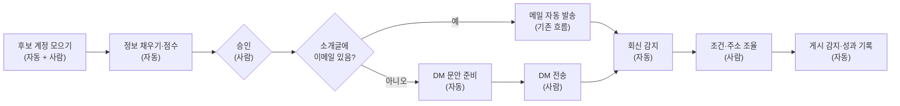

# 3. 인스타그램 해결 설계

## 핵심 생각

인스타그램 시딩에서 사람이 꼭 해야 하는 일은 두 가지입니다. **누구에게 보낼지 결정하는 것**과 **DM 전송 버튼을 누르는 것**. 나머지는 계정명 하나에서 출발해 도구가 채웁니다.

도구는 세 개로 나뉩니다. 각각 따로 돌릴 수 있어서, 필요한 것부터 하나씩 도입할 수 있습니다.

## 도구 ① 후보 채우기와 선별

**입력**: 계정명 목록. **출력**: 수치와 점수가 채워진 시트.

### 후보는 어디서 오는가

| 출처 | 방식 | 왜 좋은 후보인가 |
|---|---|---|
| 우리 계정을 태그한 사람 | 자동 | 이미 제품을 사서 올린 사람. 수락 가능성이 가장 높음 |
| 우리 게시물에 댓글을 단 사람 | 자동 | 브랜드에 관심이 있는 사람 |
| 담당자가 탐색하다 발견한 계정 | 사람이 계정명만 입력 | 사람의 안목이 들어간 후보 |
| 위 계정들과 유사 브랜드의 캡션에 @멘션된 계정 | 자동 | 비슷한 결의 계정으로 넓혀 감 |

해시태그 검색과 크리에이터 마켓플레이스 검색은 Meta 검수 뒤에 붙이는 2단계로 둡니다.

### 자동으로 채우는 값

팔로워 수, 게시물 수, 최근 게시물 12개의 평균 좋아요와 댓글, 참여율, 마지막 게시일, 최근 30일 게시 수, 릴스 조회수, 소개글에 적힌 이메일, 관련 키워드가 나온 횟수, 광고·협찬 표기 게시물 비율, 과거에 우리 브랜드를 언급했는지.

### 점수

| 기준 | 계산 | 의미 |
|---|---|---|
| 참여율 | (평균 좋아요 + 평균 댓글) ÷ 팔로워 수 | 팔로워가 실제로 반응하는가 |
| 활동성 | 최근 30일 게시 수, 마지막 게시일 | 지금도 활동하는 계정인가 |
| 적합도 | 소개글과 캡션에 관련 키워드가 나온 비율 | 술, 음식, 홈파티 등 브랜드와 결이 맞는가 |
| 광고 피로도 | 최근 게시물 중 광고·협찬 표기 비율 | 광고만 올리는 계정은 아닌가 |
| 기존 접점 | 우리를 태그하거나 댓글을 단 이력 | 가점 |

- 제외 조건: 팔로워 범위 밖, 장기간 미게시, 이미 연락한 계정, 주류 제품에 맞지 않는 계정(미성년 대상 콘텐츠 등)
- 키워드 목록, 가중치, 제외 조건은 설정 파일 하나에 모아 담당자가 직접 고칠 수 있게 합니다
- 점수 옆에 **사유를 한 줄로** 적습니다. 예: "참여율 높음, 최근 30일 8회 게시, 전통주 키워드 5회". 숫자만 보고 믿으라고 하지 않기 위해서입니다
- 최종 결정은 사람이 승인 칸에 체크하는 것으로 합니다

### 자동화가 안 되는 부분

- **개인 계정**은 API로 조회되지 않습니다. "수동 확인 필요"로 표시하고 건너뜁니다.
- **사진 분위기가 브랜드와 맞는지**는 숫자로 판단하기 어렵습니다. 그래서 점수는 순서를 정하는 데만 쓰고, 상위 후보를 사람이 훑어 승인합니다.

## 도구 ② 연락 큐

**입력**: 승인된 후보. **출력**: 오늘 연락할 목록과 준비된 문안.

1. **채널 분류**: 소개글에 이메일이 있으면 기존 메일 자동 발송 흐름으로 넘깁니다. 없으면 DM 큐에 넣습니다. 이것만으로 손으로 보내는 DM 수가 줄어듭니다.
2. **문안 준비**: 템플릿에 계정명과 제안 내용을 채워 계정별 문안을 만듭니다. AI 문안 작성은 선택 기능으로 둡니다.
3. **하루 발송량 제한**: 짧은 시간에 같은 내용의 DM을 많이 보내면 계정이 제한될 수 있습니다. 인스타그램이 허용량을 공개하지 않으므로, 낮은 값에서 시작해 설정으로 조절합니다.
4. **원클릭 준비**: 계정마다 "문안 복사"와 "DM 열기" 버튼을 제공합니다. 사람은 붙여넣고 전송만 합니다. 모바일에서는 DM 창이 바로 열리고, PC에서는 프로필이 열립니다.
5. **기록**: 전송 뒤 체크하면 연락일이 남고, 같은 계정에 두 번 연락하는 일을 막습니다.

### 왜 전송까지 자동화하지 않는가

공식 API는 상대가 먼저 메시지를 보내야만 대화를 시작할 수 있습니다. 비공식 자동 DM 프로그램은 약관 위반이고, 걸리면 브랜드 계정이 제한됩니다. 시딩보다 계정이 더 중요하므로 전송은 사람이 합니다.

## 도구 ③ 회신과 게시 추적

**입력**: 연락한 계정 목록. **출력**: 상태가 갱신된 시트.

### 회신

- 받은 DM을 읽어 답장이 온 대화를 찾고, 상태를 "회신 옴"으로 바꾸며 메시지 앞부분을 시트에 붙입니다
- 메일은 기존 흐름대로 답장 여부를 확인합니다
- 며칠간 답이 없는 계정은 "리마인드 대상" 목록으로 모읍니다
- 수락, 거절, 조건 조율은 사람이 읽고 판단합니다

### 게시

- 우리 계정을 태그한 게시물을 주기적으로 조회해 시딩한 계정과 맞춰 봅니다
- 태그 없이 올린 경우를 위해, 시딩한 계정의 최근 게시물을 다시 조회해 브랜드명과 제품명을 찾습니다
- 찾으면 게시 링크, 게시일, 좋아요, 댓글, 릴스 조회수를 기록합니다
- 광고·협찬 표기가 있는지도 함께 표시합니다. 제품을 무상으로 받은 후기는 그 사실을 밝혀야 하기 때문입니다

### 자동화가 안 되는 부분

- **스토리**는 24시간 뒤 사라지고 다른 계정의 스토리는 API로 볼 수 없습니다. 제안 문안에 "스토리에 올리실 때 계정을 태그해 주세요"를 넣고, 태그 알림이 오는 경로로 확인합니다. 이 경로는 검증이 필요합니다.
- **비공개 계정**의 게시물은 조회되지 않습니다.

## 사람이 하는 일과 도구가 하는 일

| 단계 | 사람 | 도구 |
|---|---|---|
| 발굴 | 눈에 띈 계정명을 적어 둠 | 태그·댓글·멘션에서 후보를 모음 |
| 선별 | 상위 후보를 훑고 승인 체크 | 수치 수집, 점수, 사유 작성 |
| 연락 | DM 붙여넣고 전송 | 채널 분류, 문안 준비, 발송량 관리, 중복 방지 |
| 회신 | 답장 읽고 조율 | 답장 감지, 상태 갱신, 리마인드 목록 |
| 게시 확인 | 스토리 확인 | 게시 감지, 성과 기록, 광고 표기 확인 |

## 도입 순서

| 단계 | 내용 | 필요한 것 |
|---|---|---|
| 0 | 회사 계정 연결 | 프로페셔널 계정, 페이스북 페이지 연결, Meta 개발자 앱 |
| 1 | 도구 ①②③ (접점이 있는 계정과 직접 모은 계정 기준) | Meta 검수 없이 시작 |
| 2 | 해시태그 검색, 크리에이터 마켓플레이스 검색 추가 | Meta 앱 검수 |

## 만들 것

기존에 파이썬 스크립트를 폴더에 두고 실행하시는 방식에 맞춰, 같은 방식으로 돌아가는 파이썬 도구로 만듭니다. 결과는 엑셀·CSV로 나와 기존 시트에 붙일 수 있습니다.

- [ ] 인스타그램 API 연결. 토큰이 없어도 샘플 데이터로 전체 흐름을 돌려 볼 수 있는 모드 포함
- [ ] 도구 ① 정보 채우기와 점수
- [ ] 도구 ① 후보 수집 (태그, 댓글, 캡션 멘션)
- [ ] 도구 ② 연락 큐
- [ ] 도구 ③ 회신과 게시 추적
- [ ] 비개발자용 사용 설명서
- [ ] 샤오홍슈 편
